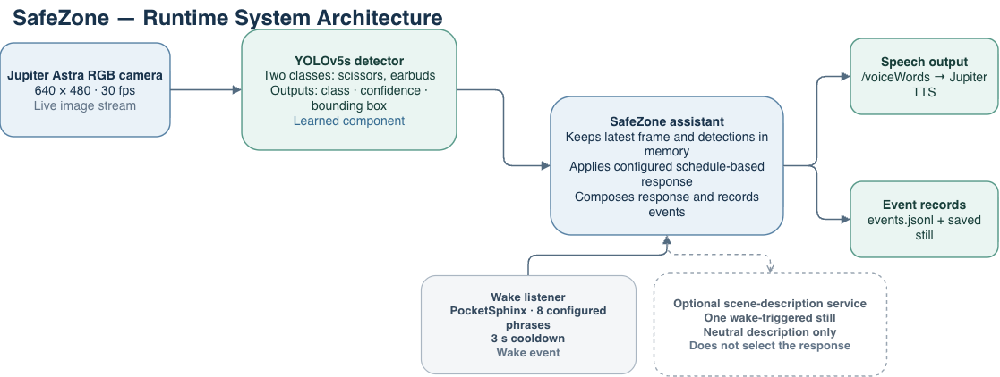
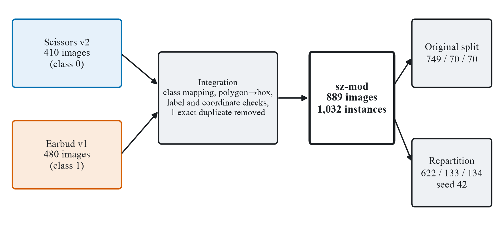
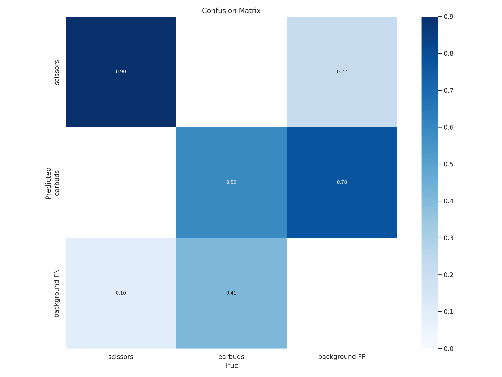
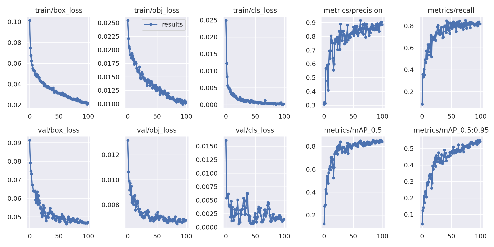
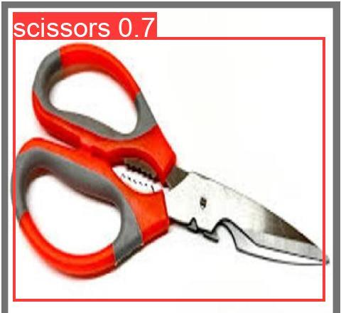

# SafeZone

**SafeZone: An Intelligent System for Real-Time Workspace Safety and
Compliance Monitoring**<br>
*Two-Class Detection of Scissors and Earbuds*

SafeZone is a prototype workspace-monitoring application integrated with the
Jupiter service robot. It combines local YOLOv5s detection, wake-phrase
interaction, optional scene description, schedule-based responses, speech,
and event logging.

> **Scope:** SafeZone detects and localizes scissors and earbuds. A detection
> alone does not determine that an object is misplaced, that earbuds are being
> worn, or that a site policy has been violated. The current implementation
> uses a local schedule to choose a response; it does not implement workspace
> zones, object tracking, or wearing-state recognition.

## Architecture



The local detector identifies objects; the assistant applies the configured
schedule, records the event, and composes the response. The optional
scene-description service provides context for a wake-triggered still image,
but does not decide whether a policy was violated.

## What the system does

1. The Astra camera publishes RGB frames at 640 x 480 and 30 frames per
   second. The assistant runs local YOLOv5s inference on incoming frames,
   using a 640-pixel model input and a default confidence threshold of 0.25.
2. The detector recognizes class 0 (`scissors`) and class 1 (`earbuds`).
   Current detections and the latest frame remain in memory during continuous
   monitoring.
3. A PocketSphinx wake listener recognizes one of eight configured phrases:
   “Hey EKD,” “Hi EKD,” “Hello EKD,” “Hey SafeZone,” “Okay SafeZone,”
   “SafeZone,” “SafeZone wake up,” and “Wake up SafeZone.”
4. An accepted wake phrase saves one current frame and starts event analysis.
   If configured, a Qwen-compatible service receives that image for a short
   scene description. Local code, not the language model, selects the
   schedule-based response.
5. The assistant publishes response text to `/safezone/response` and
   `/voiceWords`. The Jupiter speech node plays it, with local Flite fallback
   when the configured speech service fails.
6. Event details and captured images are written under
   `output/safezone/events/`. The directory and captured images use
   user-only permissions; `/output/` is Git-ignored.

## Policy modes

The launch wrapper offers three modes:

| Mode | Behavior |
| --- | --- |
| `schedule` | Uses local robot time; default work hours are 09:00-17:00 with a 12:00-13:00 break. |
| `work` | Test override that applies work-time reminders for detected targets. |
| `off_duty` | Test override that does not apply the work-time prohibition. |

These are demonstration settings, not a universal safety policy. Configure
them for the approved site rules before any operational use.

## Repository layout

| Path | Contents |
| --- | --- |
| `src/jupiterobot2/jupiterobot2_vision/jupiterobot2_vision_yolov5/` | SafeZone ROS package: assistant, wake listener, launch file, and wake configuration. |
| `ekd_yolov5/` | YOLOv5 code, dataset configuration, and retained training/evaluation records. |
| `docs/safezone.sh` | Workspace-aware launcher for the SafeZone robot demo. |
| `docs/images/` | Architecture, dataset workflow, and selected baseline-result figures used below. |
| `setup_ekd.bash` | Sources ROS Noetic and this workspace's Catkin environment; loads local `.env` when present. |
| `docs/COMMANDS.md` | Workspace build, ROS command, and SafeZone operating instructions. |
| `docs/CORE.MD` | Startup, node, and topic map. |
| `ekd_yolov5/analysis/sz-mod-training-2026-11-09/README.md` | Training configuration, evaluation results, and analysis notes. |
| `202614100009_Enoch-Kwateh-Dongbo_SafeZone-An-Intelligent-System-for-Real-Time-Workspace-Safety-and-Compliance-Monitoring.pdf` | Project report. |

## Requirements

The robot application targets a Jupiter workspace running Ubuntu with ROS
Noetic and Catkin. Runtime components include the Astra camera driver, ROS
vision packages, GStreamer/PulseAudio and PocketSphinx for wake-word input,
and the Jupiter speech package. The bundled YOLOv5 detector also requires its
PyTorch and OpenCV runtime dependencies.

The trained checkpoint is **not included in this Git repository**. The
detector expects a compatible model at
`ekd_yolov5/weights/safezone_best.pt`; supply the checkpoint locally before
launching the demo. The checkpoint must contain the `scissors` and `earbuds`
classes in that order.

## Build and launch

Run these commands on the robot or a compatible ROS Noetic environment from
the workspace root:

```bash
cd ~/ekd_catkin_ws
source /opt/ros/noetic/setup.bash
catkin_make
```

The first build creates `devel/setup.bash`, which the workspace setup helper
requires. Then start the demo:

```bash
./docs/safezone.sh
```

The wrapper loads the ROS and Catkin environments and prompts for a policy
mode in an interactive terminal. A non-interactive launch uses the default
schedule. Launch arguments can override camera or audio settings, for example:

```bash
./docs/safezone.sh camera_serial_number:=YOUR_CAMERA_SERIAL
./docs/safezone.sh audio_source:=alsasrc
```

The default audio source is `pulsesrc`. The wake listener's acoustic model
defaults to `/usr/local/share/pocketsphinx/model/en-us/en-us`; pass the
`acoustic_model:=...` argument if it is installed elsewhere.

## Optional scene description

Qwen scene description is optional. To enable it, copy `.env.example` to
`.env` and set `EKD_QWEN_API_KEY` locally:

```bash
cp .env.example .env
# Edit .env locally; do not commit it.
```

`setup_ekd.bash` loads `.env` when the workspace is sourced. Without the key,
local detection and built-in responses continue without scene description.
When enabled, the wake-triggered image is sent to the configured remote
service; obtain the required approval before using this feature with
workspace imagery. Never commit `.env` or other credentials.

## Dataset and evaluation

The `sz-mod` dataset combines two separately maintained Roboflow projects:

- [Scissors detection, version 2 (Roboflow Universe)](https://universe.roboflow.com/ekd-ekddigital-com/scissors-detection-rw9ow-7ygvi/dataset/2)
- [Earbud, version 1 (Roboflow)](https://app.roboflow.com/ekd-ekddigital-com/earbud-h45y9-idbzn/1)

The source export configurations record a CC BY 4.0 license. Project access
and download permissions remain subject to each Roboflow workspace's settings.
For local details, see the [combined dataset inventory and class map](ekd_yolov5/datasets/sz-mod/README.md),
the [combined dataset YAML](ekd_yolov5/datasets/sz-mod/data.yaml), the
[YOLOv5 training YAML](ekd_yolov5/data/sz-mod.yaml), and the
[download/preparation instructions](ekd_yolov5/datasets/README.md).

After removing one exact duplicate, the combined dataset contains 889 images
and 1,032 labeled instances. Class IDs are 0 for scissors and 1 for earbuds.
This checkout includes the combined labels and configuration, but not the
source exports or combined image files. Follow the download instructions and
use `ekd_yolov5/datasets/prepare_sz_mod.py` to reconstruct the image set.



On the original 749/70/70 train/validation/test split, the selected
100-epoch YOLOv5s checkpoint achieved these test results:

| Class | Precision | Recall | mAP@0.5 | mAP@0.5:0.95 |
| --- | ---: | ---: | ---: | ---: |
| All | 0.815 | 0.729 | 0.764 | 0.475 |
| Scissors | 0.940 | 0.900 | 0.951 | 0.673 |
| Earbuds | 0.691 | 0.559 | 0.577 | 0.277 |



The following figure shows the original run's training and validation curves.



Example held-out scissors prediction:



Scissors performance exceeded earbuds performance. A later 70/15/15
repartition produced higher scores, but reused previously examined images;
augmentation variants also were not grouped by source photograph. Treat those
results as exploratory, not as a directly comparable improvement. The
training README contains the run details and class-wise metrics.

## Limitations and responsible use

- The detector identifies objects; it does not infer a violation, object
  placement rules, or whether a person is wearing earbuds.
- Compliance decisions require approved site rules and additional context
  such as workspace zones, activity, and wearing state.
- The original test set was small and reused during model comparisons. The
  later repartition is not an independent generalization test.
- The reported approximately 8.5 ms model inference time was measured on a
  Tesla T4, not on the robot; it is not end-to-end robot latency.
- Captured frames, event images, and logs can contain sensitive information.
  Configure retention and access according to local policy.

SafeZone is a decision-support prototype for further evaluation, not a
replacement for established safety procedures or human supervision.

## Project report

The accompanying [SafeZone project report](./202614100009_Enoch-Kwateh-Dongbo_SafeZone-An-Intelligent-System-for-Real-Time-Workspace-Safety-and-Compliance-Monitoring.pdf)
describes the dataset workflow, training experiments, robot integration,
evaluation, and limitations in detail.
